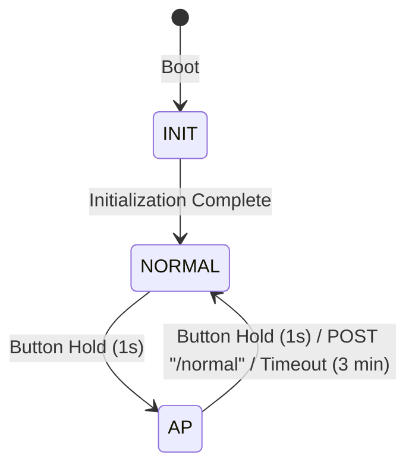

# TIST Smart Farm System

A native ESP-IDF C++ application built on **ESP-IDF v6.0.1** for ESP32. The system reads environmental and water-quality data from various sensors via Modbus RTU (RS485), hosts a local web server for configuration provisioning, automatically connects to the strongest configured Wi-Fi network, and publishes telemetry data to an MQTT broker.

---

## 🌟 Key Features

1. **Finite State Machine (FSM)**:
   * Dynamically transitions between **AP Mode** (local device provisioning) and **Normal Mode** (sensor reading and Cloud MQTT communication).
   * Supports manual state changes using a physical button hold.
   * Auto-exits AP mode to Normal mode after 3 minutes of inactivity.

2. **Modbus RTU Sensor Client (RS485)**:
   * Uses native ESP-IDF UART driver with automatic direction control (RE/DE pin) for RS485 communication.
   * Periodically queries DHT13 (Air Temp/Hum), Light Sensor (Lux), Rain Sensor, and TDS/EC Sensor.
   * Validates data integrity using CRC16 Modbus checksums.

3. **Local Provisioning Web Server (AP Mode)**:
   * Spawns a local SoftAP Wi-Fi hotspot (`AP-ESP32` / pass `12345678`).
   * Serves web-pages (`html.h`) for Wi-Fi scanning/management, Station Code/Device ID configurations, and admin login authentication (`admin/adminisme`).

4. **Cloud Connectivity (Normal Mode)**:
   * Scans nearby networks and connects to the saved Wi-Fi profile with the strongest signal (highest RSSI).
   * Synchronizes system time using SNTP (`pool.ntp.org`) set to Vietnam timezone (UTC+7).
   * Publishes serialized JSON sensor data to an MQTT topic every 10 seconds.
   * Subscribes to remote configuration commands to dynamically adjust Wi-Fi profiles or broker settings.

5. **NVS-based Storage (EEPROM Emulation)**:
   * Emulates a 4KB EEPROM using a Non-Volatile Storage (NVS) blob.
   * **Data Obfuscation**: Applies a bitwise negation (`~`) algorithm to all write/read bytes to prevent plain-text credentials exposure in raw flash memory.

6. **Indicator & Buzzer Alert**:
   * Uses a status LED (LED 2, active low) to signal system mode (OFF in AP mode, 1Hz blinking in Normal mode).
   * Generates beeps and tones using the LEDC PWM controller to indicate state transitions or connection events.

---

## 📂 Project Structure

```text
├── main/
│   ├── html/
│   │   └── html.h             # Embedded HTML/CSS/JS web pages for provisioning
│   ├── CMakeLists.txt         # Component source registry and dependency declaration
│   ├── main.cpp               # Entry point (app_main)
│   ├── main_process.cpp/.h    # Main FSM loop and system initialization
│   ├── _wifi.cpp / _wifi.h    # Wi-Fi STA manager, RSSI scanning, and MQTT client logic
│   ├── ap.cpp / ap.h          # Local SoftAP configurations and HTTP REST handlers
│   ├── button.cpp / button.h  # GPIO button polling (hold transition trigger)
│   ├── buzzer.cpp / buzzer.h  # LEDC PWM buzzer tone alerts
│   ├── led.cpp / led.h        # GPIO status LED control
│   ├── memory.cpp / memory.h  # NVS-based EEPROM emulation with bitwise negation
│   ├── rtc.cpp / rtc.h        # SNTP time sync and timezone setup
│   ├── sensor.cpp / sensor.h  # RS485 Modbus RTU communications
│   └── variable.cpp / variable.h # Global configs, structures, and memory address offsets
├── CMakeLists.txt             # Main CMake configuration file
├── sdkconfig                  # Hardware and system SDK configuration
└── README.md                  # Project documentation
```

---

## ⚙️ Technical Details

### 1. Finite State Machine (FSM)

The system state machine consists of 3 states:



* **`INIT`**: Loads NVS configurations. If NVS is empty or has a version mismatch, writes default values. Initialises peripherals (LEDs, button, RTC, sensors) and transitions to `NORMAL`.
* **`NORMAL`**: Periodically scans surrounding Wi-Fi networks, compares them with up to 5 saved profiles, and connects to the one with the highest RSSI. Publishes telemetry to the cloud every 10s and listens for remote commands.
* **`AP`**: Disables Wi-Fi Station, enables SoftAP and runs the Web Server on port 80. If no HTTP requests are received within 3 minutes (`3 * 60 * 1000 ms`), it automatically exits to `NORMAL`.

**State Transition Button Logic**:
* Polled every 50ms on **GPIO 14** (with internal pull-up).
* A hold of **1 second** (20 ticks) triggers a state transition with a non-blocking 300ms cooldown to avoid debounce triggers.

---

### 2. Modbus RTU Sensor Client & Calibration

The system communicates with 7 RS485 Modbus sensors using UART2 and controls 2 relay outputs:
* **Baudrate**: 4800 bps, 8N1.
* **Modbus Pins**: TX = **GPIO 5**, RX = **GPIO 19**, DE/RE (direction pin) = **GPIO 18**.
* **Actuator Pins**: Drainage Pump Relay = **GPIO 22**, Drip/Sprinkler Valve Relay = **GPIO 23**.

#### Register Map and Formula Table:

| Sensor | Slave ID | Function Code (FC) | Start Register (Hex) | Count | Description & Value Formula |
| :--- | :--- | :--- | :--- | :--- | :--- |
| **DHT13** | `2` | `0x04` | `0x0000` | 2 | Air humidity & temperature:<br>• `Humidity = Reg[0] / 10.0` (%RH)<br>• `Temperature = Reg[1] / 10.0` (°C) |
| **Soil Moisture** | `3` | `0x03` / `0x04` | `0x0000` | 3 | Multi-depth soil moisture:<br>• `10 cm = Reg[0] / 10.0` (%RH)<br>• `20 cm = Reg[1] / 10.0` (%RH)<br>• `40 cm = Reg[2] / 10.0` (%RH) |
| **Light Sensor** | `4` | `0x04` | `0x0003` | 2 | Cường độ ánh sáng:<br>• `Intensity = (Reg[0] << 16) \| Reg[1]` (Lux) |
| **Rain Sensor** | `5` | `0x04` | `0x0000` | 1 | Rain status:<br>• `Status = Reg[0]` (0: No rain, 1: Raining) |
| **TDS/EC Sensor** | `6` | `0x03` / `0x04` | `0x0000` | 5 | Water quality metrics:<br>• `Temp = (int16_t)Reg[0] / 10.0` (°C)<br>• `EC = Reg[2]` (µS/cm)<br>• `Salinity = Reg[3]` (ppt)<br>• `TDS = Reg[4]` (mg/L) |
| **Water Level** | `7` | `0x03` / `0x04` | `0x0000` | 1 | Water level in drainage ditch:<br>• `Level = Reg[0] / 10.0` (cm) |
| **Wind Speed** | `8` | `0x03` / `0x04` | `0x0000` | 1 | Wind speed:<br>• `Speed = Reg[0] / 10.0` (m/s) |

#### Smart Sesame Crop Management Mechanisms:
1. **Multi-depth Soil Moisture & Alerting**: Monitors soil water depletion at 10cm, 20cm, and 40cm. Immediately triggers buzzer alerts if moisture exceeds 80% (root waterlogging risk on rice soil) or drops below 30% (wilting risk).
2. **Smart Drainage Automation**: When ditch water level exceeds `max_safe_level` (15.0 cm) or rain + soil waterlogging occurs, the system automatically activates the drainage pump (GPIO 22) to drain water off sesame beds in shortest time.
3. **ET-based Micro Irrigation**: Calculates Evapotranspiration ($ET_0$) in real-time from Temperature, Solar Irradiance (Lux), and Wind speed. Automatically triggers drip/sprinkler irrigation (GPIO 23) when ET demand is high or soil moisture drops below 30%.

---

### 3. NVS Memory Address Map (EEPROM Emulation)

The 4KB memory buffer maps configurations at specific byte offsets inside the NVS blob named `"eeprom"` under namespace `"storage"` (memory.cpp):

| Address (Hex) | Size (Bytes) | Parameter | Description |
| :---: | :---: | :---: | :--- |
| `0x0000` | 2 | `_version` | Configuration storage version (Default: 37) |
| `0x0002` | 64 | `_id` | Unique Device ID |
| `0x0042` | 2 | `reset_count` | Reboots Counter |
| `0x0044` | 17 | `station_code` | Station identifier string |
| `0x0055` | 1 | `wifi_count` | Count of saved Wi-Fi networks (Max: 5) |
| `0x0056` | 165 | `wifi_ssids` | Saved Wi-Fi SSIDs (5 x 33 bytes) |
| `0x00FB` | 325 | `wifi_passwords` | Saved Wi-Fi Passwords (5 x 65 bytes) |
| `0x0240` | 33 | `ap_ssid` | SoftAP Hotspot SSID |
| `0x0261` | 65 | `ap_password` | SoftAP Hotspot Password |
| `0x02A2` | 65 | `mqtt_host` | MQTT Broker Hostname/IP |
| `0x02E3` | 65 | `mqtt_username` | MQTT Username |
| `0x0324` | 65 | `mqtt_password` | MQTT Password |
| `0x0365` | 65 | `mqtt_topic_sub` | MQTT Subscribed command topic |
| `0x03A6` | 65 | `mqtt_topic_pub` | MQTT Published telemetry topic |
| `0x03E7` | 4 | `mqtt_port` | MQTT Port (Default: 1883) |

---

### 4. MQTT Telemetry & Commands

#### Published Telemetry Schema (Every 10s):
Sent to the topic configured in `mqtt_topic_pub`:
```json
{
  "reset": 12,
  "id": "SF_TOMOCHAN_0001",
  "rtc": "2026-07-26T15:45:00",
  "dht": {
    "valid": true,
    "temperature_c": 31.5,
    "humidity_pct": 74.2
  },
  "light": {
    "valid": true,
    "intensity": 12500
  },
  "rain": {
    "valid": true,
    "status": 0,
    "lower_limit": 50,
    "hysteresis": 5,
    "reset_delay": 30,
    "sensitivity": 2
  },
  "tds": {
    "valid": true,
    "temperature_c": 28.4,
    "ec": 1412.0,
    "salinity": 0.7,
    "tds": 706.0,
    "ec_raw": 1420
  },
  "soil": {
    "valid": true,
    "moisture_10cm": 42.5,
    "moisture_20cm": 51.0,
    "moisture_40cm": 58.2,
    "min_threshold": 30.0,
    "max_threshold": 80.0,
    "waterlog_alert": false,
    "drought_alert": false
  },
  "drainage": {
    "valid": true,
    "water_level_cm": 8.4,
    "high_water_alert": false,
    "pump_active": false,
    "auto_mode": true
  },
  "irrigation": {
    "wind_valid": true,
    "wind_speed_ms": 1.4,
    "et_valid": true,
    "et_mm_day": 3.82,
    "valve_active": false,
    "auto_mode": true
  }
}
```


#### Subscribed Command Schema:
Listens on `mqtt_topic_sub`. Upon receiving the command, updates persistent settings, replies to `mqtt_topic_pub`, and reboots.
```json
{
  "cmd": "update_config",
  "wifi": {
    "ssid": "Farm_WiFi_Main",
    "pass": "farmpassword123"
  },
  "mqtt": {
    "host": "mqtt.myfarmcloud.com",
    "port": 1883,
    "user": "farm_node_01",
    "pass": "securepass"
  },
  "id": "SF_NEW_0002",
  "station_code": "SF_ZONE_B",
  "reboot": true
}
```
* **Success Reply**:
```json
{
  "status": "success",
  "message": "Configuration updated successfully"
}
```

---

## 🛠️ Build and Flash Instructions

### Prerequisites
* **Toolchain**: ESP-IDF v6.0.1 toolchain installed.
* ESP32 development board connected via USB.

### Execution Steps

1. **Activate ESP-IDF Environment**:
   Open PowerShell and execute the setup profile script:
   ```powershell
   . C:\Espressif\tools\Microsoft.v6.0.1.PowerShell_profile.ps1
   ```

2. **Configure (Optional)**:
   ```powershell
   idf.py menuconfig
   ```

3. **Build**:
   Compile the source code:
   ```powershell
   idf.py build
   ```

4. **Flash and Monitor**:
   Write the binary to target flash and open serial output (replace `COMx` with your actual serial port, e.g. `COM3`):
   ```powershell
   idf.py -p COMx flash monitor
   ```
   *(To exit the serial logs monitor, press `Ctrl + ]`)*.
